<div align="center">

# Waste Classification Using Deep Learning

**An end-to-end computer vision system that classifies waste images into Glass, Metal, Organic, Paper and Plastic, from data curation to a deployed web application.**

<br/>


<br/>

<!-- TODO: replace with clean-rerun results -->
| Best test accuracy | Macro F1 | Trainable parameters | Improvement over baseline |
|:---:|:---:|:---:|:---:|
| **93.1%** (MobileNetV2) | **0.93** | **6,405** | **+8 pts** with **400x fewer** trainable weights |

**[Live Demo](https://your-app-name.streamlit.app)** &nbsp;|&nbsp; **[Notebook](waste_classification.ipynb)** &nbsp;|&nbsp; **[Dataset](https://www.kaggle.com/datasets/mostafaabla/garbage-classification)** &nbsp;|&nbsp; **[Project Report](project_report.pdf)**

</div>

---

## Table of Contents

1. [Demo](#demo)
2. [Overview](#overview)
3. [Key Achievements](#key-achievements)
4. [System Architecture](#system-architecture)
5. [Dataset](#dataset)
6. [Data Pipeline](#data-pipeline)
7. [Model Architectures](#model-architectures)
8. [Training Procedure](#training-procedure)
9. [Design Decisions](#design-decisions)
10. [Results](#results)
11. [Engineering Challenges and Debugging](#engineering-challenges-and-debugging)
12. [Web Application](#web-application)
13. [Getting Started](#getting-started)
14. [Using the Model in Python](#using-the-model-in-python)
15. [Notebook Walkthrough](#notebook-walkthrough)
16. [Repository Structure](#repository-structure)
17. [Limitations and Future Work](#limitations-and-future-work)
18. [Tech Stack and Skills](#tech-stack-and-skills)
19. [Acknowledgments](#acknowledgments)
20. [License](#license)
21. [Author](#author)

---

## Demo

<div align="center">

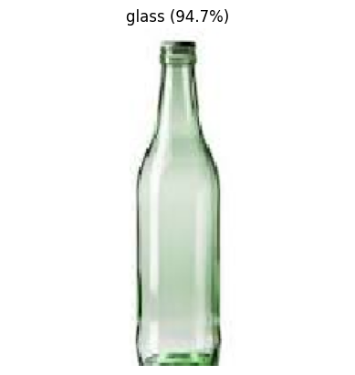

*Prediction on an image from outside the training dataset: glass, 94.7% confidence.*

</div>

<!-- TODO: after running the Streamlit app, add these files to assets/ and uncomment this block
<div align="center">
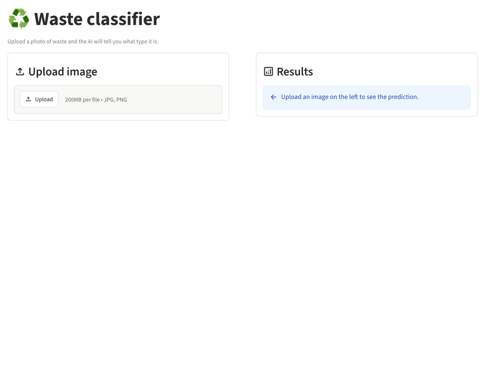
</div>

| Upload screen | Prediction result |
|:---:|:---:|
| 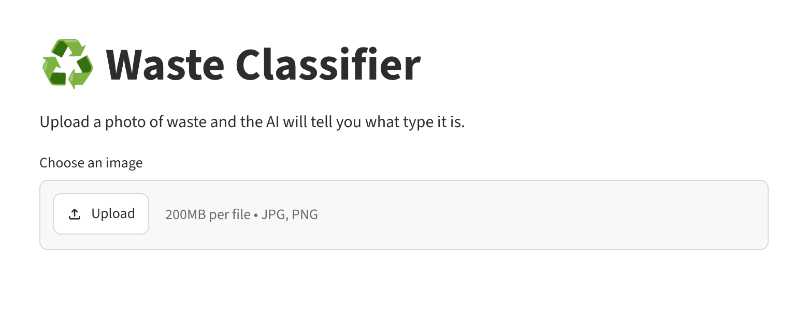 | 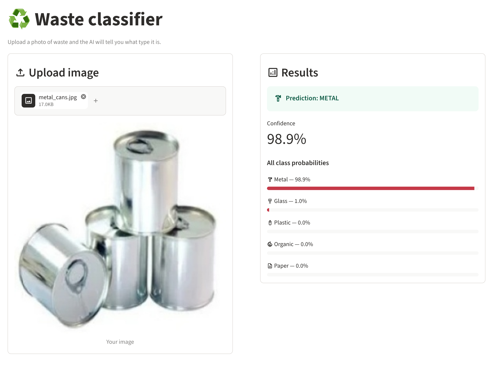 |
-->

**What the demo shows**

1. The user opens the web app and uploads a JPG or PNG image of a waste item.
2. The image is converted to RGB, resized to 224x224 and passed to the MobileNetV2 model.
3. The app displays the predicted class with its confidence, followed by probability bars for all five classes, so uncertain predictions are visible rather than hidden.

<!-- TODO: save the Cell 28 grid as assets/sample_predictions.png and uncomment
**Model predictions on the held-out test set** (green = correct, red = incorrect)

<p align="center"></p>
-->

---

## Overview

Recycling depends on correct sorting, and manual sorting is slow, inconsistent and costly. A single plastic item in a glass stream can contaminate an entire batch.

This project answers one question: **can a lightweight deep learning model reliably identify a waste item's material from an ordinary photo, and be served to an end user through a simple web interface?**

The full machine learning lifecycle was implemented:

| Stage | Work done |
|---|---|
| Data | Curated a 5-class dataset from a 12-class Kaggle source; analysed class balance, image quality and image sizes |
| Preprocessing | Stratified 70/15/15 split, resizing, normalization and on-the-fly augmentation |
| Modeling | A custom CNN baseline trained from scratch, then MobileNetV2 transfer learning |
| Evaluation | Accuracy, precision, recall, F1, confusion matrices, error analysis and real-world image tests |
| Deployment | A Streamlit web application serving the best model |
| Reliability | Detected and fixed three silent data bugs, including train/test data leakage |

---

## Key Achievements

- **Achieved 93.1% test accuracy** on 5-class waste classification, measured on a held-out stratified test set never used during training, by applying transfer learning with a frozen ImageNet-pretrained MobileNetV2 and a 6,405-parameter classification head.
- **Improved accuracy by 8 percentage points** over a from-scratch CNN, measured under identical data, optimizer, loss and callbacks, by replacing 2.6M learned weights with pretrained features and training 400x fewer parameters.
- **Eliminated train/test data leakage**, measured by a filename-overlap audit returning 0 shared images, by making every data-preparation step idempotent and adding an automated overlap check.
- **Guaranteed training/serving parity**, measured by identical predictions in the notebook and the web app on the same unseen image (glass, 94.7%), by embedding normalization and augmentation inside the model graph.
- **Fixed a silent label-mapping bug** that displayed predictions under the wrong class names, measured by a corrected classification report and prediction grid, by deriving class names directly from the data pipeline.
- **Prevented overfitting in a 2.6M-parameter CNN**, measured by training and validation curves staying within a few points of each other across 30 epochs, by combining data augmentation, 50% dropout and early stopping.
- **Delivered a usable product**, measured by a working upload-and-predict web application with per-class confidence bars, by building a Streamlit front end that caches the model and reproduces the exact training preprocessing.

---

## System Architecture

```mermaid
%%{init: {'theme': 'base', 'themeVariables': {'background': '#0d1117', 'lineColor': '#8b949e', 'textColor': '#0d1117', 'edgeLabelBackground': '#ffffff', 'clusterBkg': '#161b22', 'clusterBorder': '#30363d', 'titleColor': '#e6edf3', 'fontFamily': 'Arial', 'fontSize': '15px'}}}%%
flowchart TB
    subgraph BG[" "]
        direction TB
        subgraph S1["Data Layer"]
            A["Kaggle dataset<br/>12 classes, ~15.5k images"]:::blue
            B["Class mapping<br/>12 to 5 classes"]:::blue
            C["Data understanding<br/>counts, samples, shapes"]:::blue
            A --> B --> C
        end

        subgraph S2["Preprocessing Layer"]
            D["Stratified split<br/>70 / 15 / 15, seed 42"]:::orange
            E["Load and resize<br/>224x224, one-hot, batch 32"]:::orange
            F["Augmentation<br/>flip, rotate, zoom"]:::orange
            D --> E --> F
        end

        subgraph S3["Modeling Layer"]
            G1["Custom CNN<br/>2.6M trainable params"]:::green
            G2["MobileNetV2<br/>frozen base + 6.4K head"]:::green
        end

        subgraph S4["Evaluation Layer"]
            H["Accuracy, Precision, Recall<br/>F1, Confusion Matrix"]:::purple
            H2["Unseen real-world images"]:::purple
        end

        subgraph S5["Serving Layer"]
            I["Saved model<br/>.keras"]:::pink
            J["Streamlit web app<br/>upload and predict"]:::white
        end

        C --> D
        F --> G1
        F --> G2
        G1 --> H
        G2 --> H
        H --> H2
        H2 -->|best model| I
        I --> J
    end

    classDef blue fill:#79c0ff,stroke:#ffffff,stroke-width:1px,color:#0d1117
    classDef orange fill:#ffa657,stroke:#ffffff,stroke-width:1px,color:#0d1117
    classDef green fill:#7ee787,stroke:#ffffff,stroke-width:1px,color:#0d1117
    classDef purple fill:#d2a8ff,stroke:#ffffff,stroke-width:1px,color:#0d1117
    classDef pink fill:#ff9bce,stroke:#ffffff,stroke-width:1px,color:#0d1117
    classDef white fill:#ffffff,stroke:#8b949e,stroke-width:1px,color:#0d1117

    style BG fill:#0d1117,stroke:#0d1117
    style S1 fill:#161b22,stroke:#30363d,color:#e6edf3
    style S2 fill:#161b22,stroke:#30363d,color:#e6edf3
    style S3 fill:#161b22,stroke:#30363d,color:#e6edf3
    style S4 fill:#161b22,stroke:#30363d,color:#e6edf3
    style S5 fill:#161b22,stroke:#30363d,color:#e6edf3
```

---

## Dataset

**Source:** [Garbage Classification (12 classes)](https://www.kaggle.com/datasets/mostafaabla/garbage-classification) by Mostafa Mohamed, Kaggle.

This dataset was chosen because it is one of the few public waste datasets that contains an organic class (`biological`) alongside all four recyclable materials.

### Class mapping

| Target class | Source folders | Rationale |
|---|---|---|
| glass | `brown-glass`, `green-glass`, `white-glass` | Colour does not change the recycling stream |
| metal | `metal` | Direct mapping |
| organic | `biological` | Renamed to match the problem statement |
| paper | `paper` | Direct mapping |
| plastic | `plastic` | Direct mapping |

Excluded as out of scope: `battery`, `cardboard`, `clothes`, `shoes`, `trash`.

### Class distribution and split

<!-- TODO: verify these counts against the output of Cell 7 and Cell 11 -->
| Class | Total | Train (70%) | Validation (15%) | Test (15%) |
|---|---:|---:|---:|---:|
| glass | 2,011 | 1,407 | 301 | 303 |
| metal | 769 | 538 | 115 | 116 |
| organic | 985 | 689 | 147 | 149 |
| paper | 1,050 | 735 | 157 | 158 |
| plastic | 865 | 605 | 129 | 131 |
| **Total** | **5,680** | **3,974** | **849** | **857** |

<p align="center">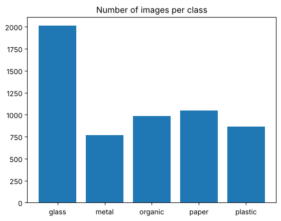</p>

### Data understanding findings

| Finding | Impact on the project |
|---|---|
| Glass has about 2x more images than other classes | Stratified split; evaluation by per-class precision, recall and macro F1 instead of accuracy alone |
| Images come in many resolutions (e.g. 384x512, 225x225, 183x275) | All images resized to 224x224 at load time |
| Most photos have plain white backgrounds; some carry stock-photo watermarks | Identified as a real-world generalization risk; tested separately on unseen photos |
| Pixel values range from 0 to 255 | Normalization layer added inside each model |

<!-- TODO: save the Cell 8 figure as assets/sample_images.png and uncomment
<p align="center"></p>
-->

---

## Data Pipeline

```mermaid
%%{init: {'theme': 'base', 'themeVariables': {'background': '#0d1117', 'lineColor': '#8b949e', 'textColor': '#0d1117', 'edgeLabelBackground': '#ffffff', 'clusterBkg': '#161b22', 'clusterBorder': '#30363d', 'titleColor': '#e6edf3', 'fontFamily': 'Arial', 'fontSize': '15px'}}}%%
flowchart LR
    subgraph BG[" "]
        direction LR
        A["5,680 images<br/>5 class folders"]:::blue --> S{"Stratified split<br/>per class, seed 42"}:::white
        S --> T["Train 70%<br/>3,974 images"]:::green
        S --> V["Validation 15%<br/>849 images"]:::yellow
        S --> X["Test 15%<br/>857 images"]:::red
        T --> AUG["Augmentation<br/>training only"]:::orange
        AUG --> M["Model training"]:::purple
        V -->|early stopping signal| M
        X -->|final one-time evaluation| R["Reported metrics"]:::white
        T -.->|overlap audit = 0| CHK["Leakage check"]:::pink
        X -.-> CHK
    end

    classDef blue fill:#79c0ff,stroke:#ffffff,stroke-width:1px,color:#0d1117
    classDef orange fill:#ffa657,stroke:#ffffff,stroke-width:1px,color:#0d1117
    classDef green fill:#7ee787,stroke:#ffffff,stroke-width:1px,color:#0d1117
    classDef yellow fill:#e3b341,stroke:#ffffff,stroke-width:1px,color:#0d1117
    classDef red fill:#ff7b72,stroke:#ffffff,stroke-width:1px,color:#0d1117
    classDef purple fill:#d2a8ff,stroke:#ffffff,stroke-width:1px,color:#0d1117
    classDef pink fill:#ff9bce,stroke:#ffffff,stroke-width:1px,color:#0d1117
    classDef white fill:#ffffff,stroke:#8b949e,stroke-width:1px,color:#0d1117

    style BG fill:#0d1117,stroke:#0d1117
```

| Step | Implementation | Purpose |
|---|---|---|
| Split | Per-class shuffle with `random.seed(42)`, 70/15/15 | Reproducible, class-balanced train, validation and test sets |
| Resize | `image_dataset_from_directory(image_size=(224, 224))` | Fixed input shape; 224 is MobileNetV2's native resolution |
| Labels | `label_mode="categorical"` (one-hot) | Pairs with categorical cross-entropy |
| Ordering | `shuffle=True` for train, `shuffle=False` for validation and test | Random training order; stable alignment of predictions and labels |
| Normalize | `Rescaling(1/255)` for the CNN, `Rescaling(1/127.5, offset=-1)` for MobileNetV2 | Stable training; matches each model's expected input range |
| Augment | `RandomFlip("horizontal")`, `RandomRotation(0.1)`, `RandomZoom(0.1)` | Reduces overfitting; active only during training |
| Batch | `batch_size=32` | Fits GPU memory with stable gradient updates |

<p align="center">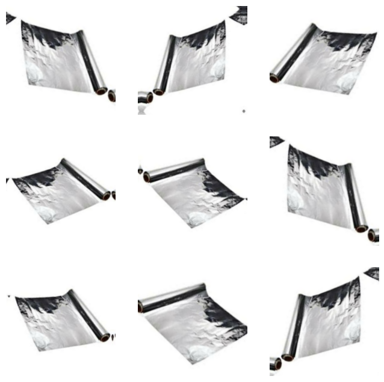</p>

---

## Model Architectures

### Model 1: Custom CNN (baseline, trained from scratch)

```mermaid
%%{init: {'theme': 'base', 'themeVariables': {'background': '#0d1117', 'lineColor': '#8b949e', 'textColor': '#0d1117', 'clusterBkg': '#161b22', 'clusterBorder': '#30363d', 'titleColor': '#e6edf3', 'fontFamily': 'Arial', 'fontSize': '15px'}}}%%
flowchart LR
    subgraph BG[" "]
        direction LR
        I["Input<br/>224x224x3"]:::white --> AU["Augment"]:::orange --> R["Rescale<br/>/255"]:::orange
        R --> C1["Conv 32 + Pool<br/>111x111"]:::green
        C1 --> C2["Conv 64 + Pool<br/>54x54"]:::green
        C2 --> C3["Conv 128 + Pool<br/>26x26"]:::green
        C3 --> C4["Conv 128 + Pool<br/>12x12"]:::green
        C4 --> F["Flatten<br/>18,432"]:::purple
        F --> D["Dense 128<br/>ReLU"]:::purple
        D --> DO["Dropout<br/>0.5"]:::red
        DO --> O["Softmax<br/>5 classes"]:::blue
    end

    classDef blue fill:#79c0ff,stroke:#ffffff,stroke-width:1px,color:#0d1117
    classDef orange fill:#ffa657,stroke:#ffffff,stroke-width:1px,color:#0d1117
    classDef green fill:#7ee787,stroke:#ffffff,stroke-width:1px,color:#0d1117
    classDef purple fill:#d2a8ff,stroke:#ffffff,stroke-width:1px,color:#0d1117
    classDef red fill:#ff7b72,stroke:#ffffff,stroke-width:1px,color:#0d1117
    classDef white fill:#ffffff,stroke:#8b949e,stroke-width:1px,color:#0d1117

    style BG fill:#0d1117,stroke:#0d1117
```

| Layer | Output shape | Parameters |
|---|---|---:|
| Input | (224, 224, 3) | 0 |
| Data augmentation | (224, 224, 3) | 0 |
| Rescaling (1/255) | (224, 224, 3) | 0 |
| Conv2D 32, 3x3, ReLU | (222, 222, 32) | 896 |
| MaxPooling2D | (111, 111, 32) | 0 |
| Conv2D 64, 3x3, ReLU | (109, 109, 64) | 18,496 |
| MaxPooling2D | (54, 54, 64) | 0 |
| Conv2D 128, 3x3, ReLU | (52, 52, 128) | 73,856 |
| MaxPooling2D | (26, 26, 128) | 0 |
| Conv2D 128, 3x3, ReLU | (24, 24, 128) | 147,584 |
| MaxPooling2D | (12, 12, 128) | 0 |
| Flatten | (18432) | 0 |
| Dense 128, ReLU | (128) | 2,359,424 |
| Dropout 0.5 | (128) | 0 |
| Dense 5, Softmax | (5) | 645 |
| **Total** | | **2,600,901** |

About 91% of all parameters sit in the first Dense layer, which is why dropout is placed directly after it. The filter count grows (32 to 128) while the spatial size shrinks (224 to 12), trading positional detail for higher-level features.

### Model 2: MobileNetV2 transfer learning (production model)

```mermaid
%%{init: {'theme': 'base', 'themeVariables': {'background': '#0d1117', 'lineColor': '#8b949e', 'textColor': '#0d1117', 'clusterBkg': '#161b22', 'clusterBorder': '#30363d', 'titleColor': '#e6edf3', 'fontFamily': 'Arial', 'fontSize': '15px'}}}%%
flowchart LR
    subgraph BG[" "]
        direction LR
        I["Input<br/>224x224x3"]:::white --> AU["Augment"]:::orange --> R["Rescale<br/>to [-1, 1]"]:::orange
        R --> B["MobileNetV2 base<br/>ImageNet weights, FROZEN<br/>2,257,984 params"]:::gray
        B --> G["Global Average Pooling<br/>7x7x1280 to 1280"]:::purple
        G --> DO["Dropout<br/>0.2"]:::red
        DO --> O["Dense 5, Softmax<br/>6,405 trainable params"]:::green
    end

    classDef orange fill:#ffa657,stroke:#ffffff,stroke-width:1px,color:#0d1117
    classDef green fill:#7ee787,stroke:#ffffff,stroke-width:2px,color:#0d1117
    classDef purple fill:#d2a8ff,stroke:#ffffff,stroke-width:1px,color:#0d1117
    classDef red fill:#ff7b72,stroke:#ffffff,stroke-width:1px,color:#0d1117
    classDef gray fill:#c9d1d9,stroke:#ffffff,stroke-width:2px,stroke-dasharray:5 5,color:#0d1117
    classDef white fill:#ffffff,stroke:#8b949e,stroke-width:1px,color:#0d1117

    style BG fill:#0d1117,stroke:#0d1117
```

| Component | Configuration |
|---|---|
| Backbone | MobileNetV2, `include_top=False`, `weights="imagenet"`, `trainable=False` |
| Input scaling | `Rescaling(1/127.5, offset=-1)` to match the backbone's training range |
| Pooling | `GlobalAveragePooling2D`: 7x7x1280 feature maps reduced to a 1,280-dimensional vector |
| Head | `Dropout(0.2)` followed by `Dense(5, softmax)` |
| Parameters | 2,264,389 total, 6,405 trainable, 2,257,984 frozen |

### Model comparison

| | Custom CNN | MobileNetV2 |
|---|---:|---:|
| Total parameters | 2,600,901 | 2,264,389 |
| Trainable parameters | 2,600,901 | 6,405 |
| Pretrained knowledge | None | ImageNet (1.4M images, 1,000 classes) |
| Validation accuracy after epoch 1 | ~47% | ~87% |
| Epochs to plateau | ~30 | ~5 |
| Saved model size | ~10 MB | ~9 MB |

---

## Training Procedure

```mermaid
%%{init: {'theme': 'base', 'themeVariables': {'background': '#0d1117', 'lineColor': '#8b949e', 'textColor': '#0d1117', 'edgeLabelBackground': '#ffffff', 'clusterBkg': '#161b22', 'clusterBorder': '#30363d', 'titleColor': '#e6edf3', 'fontFamily': 'Arial', 'fontSize': '15px'}}}%%
flowchart TB
    subgraph BG[" "]
        direction TB
        A["Batch of 32<br/>training images"]:::blue --> B["Forward pass<br/>predict probabilities"]:::green
        B --> C["Categorical<br/>cross-entropy loss"]:::orange
        C --> D["Backpropagation<br/>compute gradients"]:::purple
        D --> E["Adam optimizer<br/>update weights"]:::pink
        E -->|next batch| A
        E --> F{"End of epoch:<br/>val_loss improved?"}:::white
        F -->|yes| G["Store best weights"]:::green
        F -->|no for 5 epochs| H["Stop and restore<br/>best weights"]:::red
        G -->|next epoch| A
    end

    classDef blue fill:#79c0ff,stroke:#ffffff,stroke-width:1px,color:#0d1117
    classDef orange fill:#ffa657,stroke:#ffffff,stroke-width:1px,color:#0d1117
    classDef green fill:#7ee787,stroke:#ffffff,stroke-width:1px,color:#0d1117
    classDef purple fill:#d2a8ff,stroke:#ffffff,stroke-width:1px,color:#0d1117
    classDef pink fill:#ff9bce,stroke:#ffffff,stroke-width:1px,color:#0d1117
    classDef red fill:#ff7b72,stroke:#ffffff,stroke-width:1px,color:#0d1117
    classDef white fill:#ffffff,stroke:#8b949e,stroke-width:1px,color:#0d1117

    style BG fill:#0d1117,stroke:#0d1117
```

### Hyperparameters

| Parameter | Custom CNN | MobileNetV2 |
|---|---|---|
| Input size | 224x224x3 | 224x224x3 |
| Batch size | 32 | 32 |
| Optimizer | Adam (learning rate 0.001) | Adam (learning rate 0.001) |
| Loss | Categorical cross-entropy | Categorical cross-entropy |
| Maximum epochs | 30 | 15 |
| Early stopping | `val_loss`, patience 5, restore best weights | `val_loss`, patience 5, restore best weights |
| Dropout | 0.5 | 0.2 |
| Augmentation | Flip (horizontal), rotation 0.1, zoom 0.1 | Same |
| Random seed (split) | 42 | 42 |
| Hardware | Google Colab, NVIDIA T4 GPU | Google Colab, NVIDIA T4 GPU |
| Training time | ~10-15 min | ~5-8 min |

---

## Design Decisions

| # | Condition | Action taken | Outcome |
|---|---|---|---|
| 1 | If the dataset has 12 classes but the problem needs 5 | then the 3 glass colours were merged and `biological` renamed to `organic` through an explicit `class_map` | to achieve a dataset aligned with the problem, with a reviewable mapping |
| 2 | If the classes are imbalanced (glass about 2x) | then the split was stratified and results reported as per-class precision, recall, F1 and macro F1 | to achieve metrics that cannot hide a weak minority class behind high accuracy |
| 3 | If images arrive in many resolutions | then every image was resized to 224x224 at load time | to achieve a fixed input shape that also matches MobileNetV2's native resolution |
| 4 | If preprocessing written in application code can drift from training | then rescaling and augmentation were placed inside the model graph | to achieve training/serving parity: the app sends raw pixels and cannot apply preprocessing incorrectly |
| 5 | If about 4,000 training images is small for a 2.6M-parameter CNN | then on-the-fly augmentation and Dropout(0.5) were added | to achieve generalization instead of memorization |
| 6 | If the optimal number of epochs is unknown | then EarlyStopping on `val_loss` with patience 5 and best-weight restoration was used | to achieve automatic stopping at the best-generalizing weights |
| 7 | If three convolution blocks leave a 26x26x128 feature map (about 11M Dense weights) | then a fourth convolution block was added | to achieve a 4x smaller Dense layer and lower overfitting risk |
| 8 | If the baseline CNN plateaus around 85% | then transfer learning with a frozen MobileNetV2 was applied | to achieve +8 points of accuracy while training only 6,405 weights |
| 9 | If a randomly initialized head sends large gradients into a pretrained network | then the backbone was frozen (`trainable=False`) | to achieve preservation of the pretrained ImageNet features |
| 10 | If flattening 7x7x1280 features produces 62,720 values | then GlobalAveragePooling2D was used | to achieve a compact 1,280-dimensional feature vector and a small head |
| 11 | If MobileNetV2 was trained on inputs scaled to [-1, 1] | then `Rescaling(1/127.5, offset=-1)` was used | to achieve inputs that match the backbone's training distribution |
| 12 | If two models must be compared fairly | then the data, split, optimizer, loss and callbacks were kept identical | to achieve a controlled experiment where only the architecture changes |
| 13 | If class names are typed by hand | then class names were read from `train_ds.class_names` | to achieve a single source of truth for the label-to-index mapping |
| 14 | If notebook cells that copy files are re-run | then each step deletes its output folder before rebuilding it | to achieve idempotent data preparation with no duplicated or leaked files |
| 15 | If Streamlit re-runs the entire script on every interaction | then model loading was wrapped in `@st.cache_resource` | to achieve a single model load per session and fast predictions |
| 16 | If users upload 4-channel PNG images | then every upload is converted with `.convert("RGB")` | to achieve robust inference that does not fail on transparent images |

---

## Results

<!-- TODO: replace every number in this section with clean-rerun results -->

### Model comparison on the held-out test set

| Model | Test accuracy | Macro F1 | Trainable parameters |
|---|:---:|:---:|:---:|
| Majority-class baseline (always "glass") | 35.4% | - | - |
| Custom CNN | 85.0% | 0.83 | 2,600,901 |
| **MobileNetV2 (frozen backbone)** | **93.1%** | **0.93** | **6,405** |

<p align="center">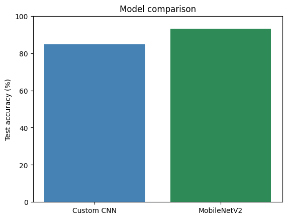</p>

### Training and validation curves

| Custom CNN | MobileNetV2 |
|:---:|:---:|
| 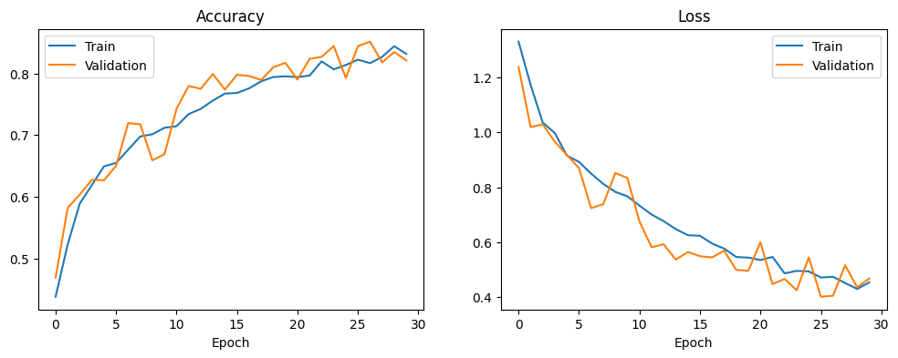 | 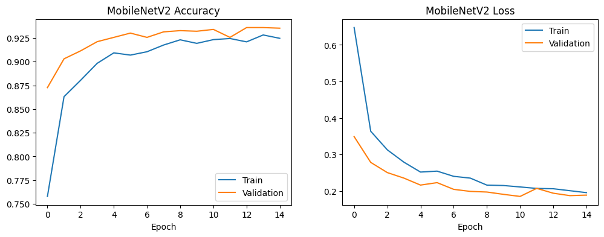 |

- **Custom CNN:** training and validation accuracy rise together across 30 epochs with no overfitting. Validation loss was still decreasing at epoch 30, so the model was slightly under-trained.
- **MobileNetV2:** reaches about 87% validation accuracy after a single epoch and plateaus by about epoch 5, the expected behaviour of transfer learning.
- In both models validation accuracy sometimes exceeds training accuracy, because dropout and augmentation are active only during training.

### Per-class performance

| Class | CNN Precision | CNN Recall | CNN F1 | MobileNetV2 Precision | MobileNetV2 Recall | MobileNetV2 F1 |
|---|:---:|:---:|:---:|:---:|:---:|:---:|
| glass | 0.88 | 0.87 | 0.87 | 0.94 | 0.92 | 0.93 |
| metal | 0.69 | 0.73 | 0.71 | 0.83 | 0.94 | 0.88 |
| organic | 0.95 | 0.86 | 0.90 | 0.98 | 0.99 | 0.99 |
| paper | 0.85 | 0.95 | 0.90 | 0.96 | 0.95 | 0.96 |
| plastic | 0.80 | 0.75 | 0.77 | 0.91 | 0.85 | 0.88 |
| **Macro average** | **0.83** | **0.83** | **0.83** | **0.92** | **0.93** | **0.93** |

### Confusion matrices

<p align="center">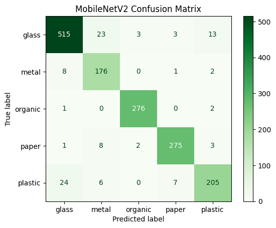</p>

<!-- TODO: save the Cell 27 matrix as assets/cnn_confusion_matrix.png and add it next to the MobileNetV2 matrix -->

### Error analysis

| Error pattern | Likely cause |
|---|---|
| Plastic predicted as glass (most frequent) | Transparent plastic bottles share shape, gloss and see-through texture with glass |
| Glass predicted as metal | Reflective glass surfaces resemble metallic shine |
| Organic produce in plastic packaging predicted as glass | The model reacts to the shiny transparent wrapper rather than its contents |
| Metal predicted with lower confidence (61-70%) | Metal is the smallest class (769 images) |
| Organic is classified almost perfectly | Food has distinctive colours and textures unlike any other class |

### Real-world test on unseen images

Images collected outside the Kaggle dataset.

<!-- TODO: add your own test images -->
| Image | True class | Predicted | Confidence | Correct |
|---|---|---|:---:|:---:|
| Green glass bottle | glass | glass | 94.7% | Yes |
| Clear plastic water bottle | plastic | | | |
| Crushed aluminium can | metal | | | |
| Banana peel | organic | | | |
| Newspaper | paper | | | |

<p align="center"></p>

---

## Engineering Challenges and Debugging

### 1. Phantom classes

| | |
|---|---|
| **Symptom** | The class distribution chart showed 8 classes instead of 5; `train`, `val` and `test` appeared as categories. |
| **Root cause** | Folders from an earlier experiment were written into the dataset directory. Keras treats every sub-folder as a class. |
| **Fix** | Removed the stray folders and moved split output to a separate directory (`split_data/`). |
| **Prevention** | The class list is verified before training: the loader must report exactly 5 classes. |

### 2. Shifted labels

| | |
|---|---|
| **Symptom** | Glass bottles were labelled "plastic" and cans "paper", in both the true and the predicted labels. |
| **Root cause** | A hand-written class-name list (dictionary order) did not match TensorFlow's alphabetical index order. |
| **Diagnosis** | Because the true labels were also wrong, the model could be ruled out; the fault was in the index-to-name lookup. |
| **Fix** | `class_names = train_ds.class_names`, a single source of truth tied to the data pipeline. |

### 3. Train/test data leakage

| | |
|---|---|
| **Symptom** | The test set contained 1,554 images instead of the expected 857, and every confusion-matrix row total was inflated. |
| **Root cause** | The split cell ran twice with different class orderings. Files were only ever added, never removed, so two different random splits merged and the same images ended up in both train and test. Two random 15% selections combined cover about 27.75% of the data, matching the observed size. |
| **Fix** | Each data-preparation step now deletes its output folder before rebuilding (`shutil.rmtree`). Training was re-run from a clean runtime. |
| **Prevention** | An automated audit counts filenames shared between train and test; it must return 0. Split sizes and confusion-matrix row totals are checked against expected values. |

---

## Web Application

```mermaid
%%{init: {'theme': 'base', 'themeVariables': {'background': '#0d1117', 'lineColor': '#8b949e', 'textColor': '#0d1117', 'edgeLabelBackground': '#ffffff', 'clusterBkg': '#161b22', 'clusterBorder': '#30363d', 'titleColor': '#e6edf3', 'fontFamily': 'Arial', 'fontSize': '15px'}}}%%
flowchart TB
    subgraph BG[" "]
        direction TB
        U["User uploads a JPG / PNG image"]:::white
        subgraph SV["Streamlit server"]
            P1["Convert to RGB"]:::orange
            P2["Resize to 224x224"]:::orange
            P3["float32 array, batch of 1"]:::orange
            M["MobileNetV2 .keras<br/>loaded once per session"]:::green
            P4["argmax and class-name lookup"]:::purple
        end
        OUT["Prediction, confidence<br/>and per-class probability bars"]:::white
        U --> P1 --> P2 --> P3 --> M --> P4 --> OUT
    end

    classDef orange fill:#ffa657,stroke:#ffffff,stroke-width:1px,color:#0d1117
    classDef green fill:#7ee787,stroke:#ffffff,stroke-width:1px,color:#0d1117
    classDef purple fill:#d2a8ff,stroke:#ffffff,stroke-width:1px,color:#0d1117
    classDef white fill:#ffffff,stroke:#8b949e,stroke-width:1px,color:#0d1117

    style BG fill:#0d1117,stroke:#0d1117
    style SV fill:#161b22,stroke:#30363d,color:#e6edf3
```

### Features

| Feature | Implementation |
|---|---|
| Image upload | `st.file_uploader`, accepting JPG, JPEG and PNG |
| Robust input handling | `.convert("RGB")` handles grayscale and transparent images |
| Preprocessing parity | Same resize and batching as training; normalization happens inside the model |
| Fast responses | `@st.cache_resource` loads the model once per session |
| Transparent output | Predicted class, confidence and a probability bar for every class |

### Core inference logic (`app.py`)

```python
image = Image.open(uploaded_file).convert("RGB")
resized = image.resize((224, 224))
img_batch = np.expand_dims(np.array(resized, dtype="float32"), 0)

prediction = model.predict(img_batch)[0]
predicted_class = class_names[np.argmax(prediction)]
confidence = np.max(prediction) * 100
```

---

## Getting Started

### Prerequisites

- Python 3.10, 3.11 or 3.12
- pip
- The TensorFlow version used for training (see `requirements.txt`)

### Run the web application locally

```bash
git clone https://github.com/sidhantds/Waste-Classification.git
```

```bash
cd Waste-Classification
```

```bash
pip install -r requirements.txt
```

```bash
streamlit run app.py
```

Open `http://localhost:8501` in a browser.

`requirements.txt`:

```
streamlit
tensorflow==2.19.0
pillow
numpy
```

Saved `.keras` models are version-sensitive. Keep `tensorflow` pinned to the version used in training.

### Reproduce training

1. Open `waste_classification.ipynb` in Google Colab.
2. Select **Runtime > Change runtime type > T4 GPU**.
3. Select **Runtime > Run all**. The dataset downloads automatically through `kagglehub`.
4. Trained models are saved as `waste_cnn.keras` and `waste_mobilenetv2.keras`.

### Deploy to Streamlit Community Cloud

1. Push the repository to GitHub.
2. Sign in at [share.streamlit.io](https://share.streamlit.io) with GitHub.
3. Select **New app**, choose this repository, and set the main file path to `app.py`.
4. Deploy. The public URL can be used as the live demo link at the top of this README.

---

## Using the Model in Python

```python
import numpy as np
import tensorflow as tf
from PIL import Image

model = tf.keras.models.load_model("waste_mobilenetv2.keras")
class_names = ["glass", "metal", "organic", "paper", "plastic"]

image = Image.open("bottle.jpg").convert("RGB").resize((224, 224))
batch = np.expand_dims(np.array(image, dtype="float32"), 0)

probabilities = model.predict(batch)[0]
print(class_names[np.argmax(probabilities)], round(float(np.max(probabilities)) * 100, 1))
```

Pass raw pixel values (0-255). Normalization is performed inside the model.

---

## Notebook Walkthrough

| Section | Cells | Description |
|---|---|---|
| Setup | 1 | Import libraries; verify TensorFlow version and GPU |
| Data acquisition | 2-4 | Download the dataset with `kagglehub`; inspect the folder structure |
| Class mapping | 5-6 | Map 12 source classes to 5 targets; build the clean dataset idempotently |
| Data understanding | 7-9 | Class counts and distribution chart; sample images; image shape analysis |
| Train/validation/test split | 10-11, A | Stratified 70/15/15 split; size verification; train/test overlap audit |
| Loading and preprocessing | 12-14 | Load and resize images, one-hot labels, batch inspection, normalization |
| Augmentation | 15-16 | Define augmentation layers; visualize augmented samples |
| Custom CNN | 17-23 | Build, summarize, compile, early stopping, train, plot curves, save |
| CNN evaluation | 24-28 | Test accuracy, classification report, confusion matrix, prediction grid |
| Transfer learning | 29-34 | Load frozen MobileNetV2, build head, summarize, compile, train, plot curves |
| Transfer learning evaluation | 35-39 | Test accuracy, classification report, confusion matrix, model comparison, save |
| Unseen images | 40-41 | Upload new photos and predict |

---

## Repository Structure

```
Waste-Classification/
├── assets/                          Charts, confusion matrices, screenshots
├── app.py                           Streamlit inference application
├── requirements.txt                 Pinned dependencies
├── waste_mobilenetv2.keras          Production model (MobileNetV2)
├── waste_classification.ipynb       End-to-end pipeline: data, models, evaluation
├── project_report.pdf               Final project report
├── LICENSE
└── README.md
```

---

## Limitations and Future Work

| Limitation | Planned improvement |
|---|---|
| Most training photos have plain white backgrounds; cluttered real-world scenes may score lower | Collect real-world photos; add background-replacement augmentation |
| Glass and plastic are confused on transparent items | Add transparent-plastic samples; fine-tune the top MobileNetV2 blocks with a learning rate of 1e-5 |
| Mild class imbalance | Class weights or targeted oversampling |
| One object per image | Object detection (e.g. YOLO) for mixed-waste scenes |
| A single train/test split | k-fold cross-validation for tighter performance estimates |
| Server-side inference only | TensorFlow Lite conversion for on-device mobile inference |

---

## Tech Stack and Skills

| Area | Details |
|---|---|
| Languages and frameworks | Python, TensorFlow, Keras, scikit-learn, NumPy, Matplotlib, Pillow, Streamlit |
| Deep learning | CNN design, transfer learning, regularization (dropout, augmentation), early stopping |
| Computer vision | Image preprocessing, resizing, normalization, augmentation strategy |
| ML engineering | Reproducible stratified splits, data-leakage detection, training/serving parity, model serialization |
| Evaluation | Precision, recall, F1, macro and weighted averages, confusion-matrix error analysis, baselines |
| Debugging | Root-cause analysis of silent data bugs, sanity checks, idempotent pipelines |
| Deployment | Streamlit web application, model caching, dependency pinning, Streamlit Community Cloud |
| Tools | Google Colab (T4 GPU), Kaggle, Git, GitHub, VS Code |

---

## Acknowledgments

- Dataset: [Garbage Classification (12 classes)](https://www.kaggle.com/datasets/mostafaabla/garbage-classification) by Mostafa Mohamed, Kaggle.
- Pretrained model: MobileNetV2 ([Sandler et al., 2018](https://arxiv.org/abs/1801.04381)) with ImageNet weights, via `tf.keras.applications`.
- Developed as part of a Deep Learning internship.

---

## License

This project is licensed under the MIT License. See [LICENSE](LICENSE) for details. The dataset is subject to its own license on Kaggle.

---

## Author

**Sidhant Pujara**
Deep Learning Intern, Computer Vision and ML Engineering

[](https://linkedin.com/in/your-profile)
[](https://github.com/sidhantds)
