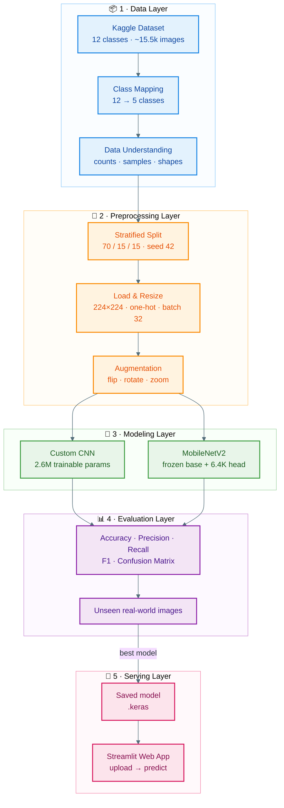
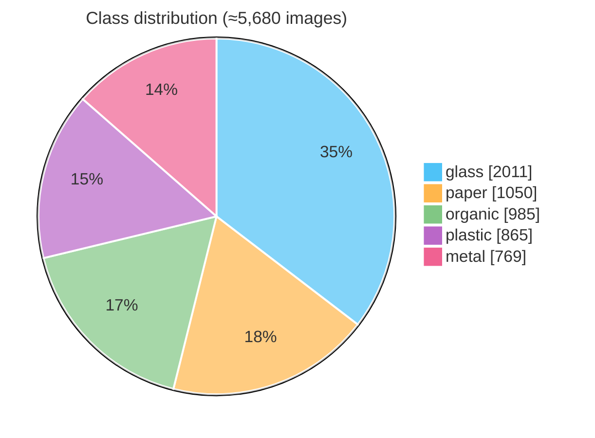
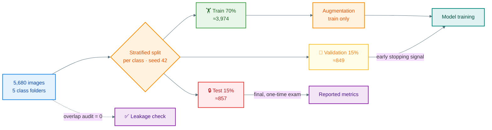
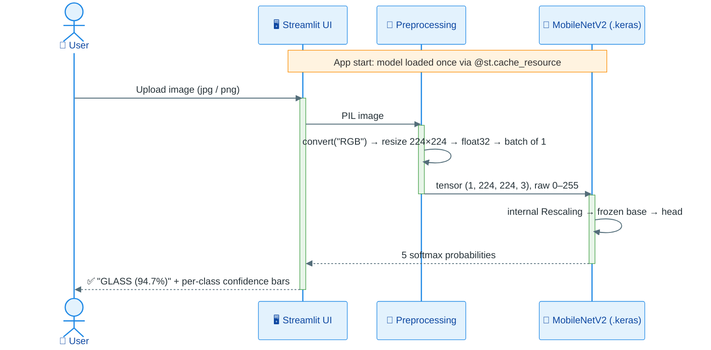

<div align="center">

# ♻️ Waste Classification Using Deep Learning

### An end-to-end computer vision system that sorts waste into **Glass · Metal · Organic · Paper · Plastic** from a single photo

<br/>


<br/>

<!-- TODO: replace both numbers with your clean-rerun results -->
| 🎯 Best test accuracy | 🧠 Trainable params | ⚡ Gain over baseline CNN | 🖼️ Images |
|:---:|:---:|:---:|:---:|
| **~93%** (MobileNetV2) | **6,405** | **+8 pts** with **400× fewer** trainable weights | **5,680** |

<br/>

<!-- Add a screenshot of the running Streamlit app -->


</div>

---

## 📌 Table of Contents

1. [Why This Project](#-why-this-project)
2. [Key Achievements](#-key-achievements)
3. [System Architecture](#️-system-architecture)
4. [Dataset](#-dataset)
5. [Data Pipeline](#-data-pipeline)
6. [Model Architectures](#-model-architectures)
7. [Design Decisions](#-design-decisions)
8. [Results](#-results)
9. [Engineering Challenges & Debugging](#-engineering-challenges--debugging)
10. [Streamlit Application](#-streamlit-application)
11. [Getting Started](#-getting-started)
12. [Repository Structure](#-repository-structure)
13. [Limitations & Future Work](#-limitations--future-work)
14. [Skills Demonstrated](#-skills-demonstrated)
15. [Acknowledgments](#-acknowledgments)

---

## 💡 Why This Project

Recycling only works if waste is sorted correctly, and **manual sorting is slow, inconsistent and expensive**. A single plastic bottle in the glass stream can contaminate an entire batch.

This project answers one question:

> **Can a lightweight deep learning model reliably identify waste material from an ordinary photo, and be served to an end user through a simple web app?**

I built the full lifecycle: **data curation → preprocessing → two competing models → rigorous evaluation → deployment**. Along the way I found and fixed three silent data bugs, including **train/test data leakage**.

---

## 🏆 Key Achievements

> Written in the Google **X-Y-Z** format: *Accomplished **[X]**, as measured by **[Y]**, by doing **[Z]**.*

- **Achieved ~93% test accuracy** on 5-class waste classification, **measured on** a held-out stratified test set the model never saw, **by** applying transfer learning with a frozen ImageNet-pretrained **MobileNetV2** and a 6,405-parameter classification head.
- **Improved accuracy by ~8 percentage points** over a from-scratch CNN, **measured by** test accuracy under identical data, optimizer and loss, **by** replacing 2.6M learned weights with pretrained features and training **400× fewer parameters**.
- **Eliminated train/test data leakage**, **measured by** a filename-overlap audit dropping to **0 shared images**, **by** making every data-preparation step idempotent (wipe-then-rebuild) and adding an automated overlap check.
- **Guaranteed training/serving parity**, **measured by** identical predictions in the notebook and the web app (e.g. *glass, 94.7%* on the same unseen image), **by** embedding normalization and augmentation **inside the model graph** instead of in external code.
- **Fixed a silent label-mapping bug** that displayed every prediction under the wrong name, **measured by** a corrected classification report and prediction grid, **by** deriving class names directly from the data pipeline (`train_ds.class_names`) instead of a hand-written list.
- **Prevented overfitting in a 2.6M-parameter CNN**, **measured by** training and validation curves staying within a few points of each other over 30 epochs, **by** combining on-the-fly data augmentation, 50% dropout and early stopping on validation loss.
- **Shipped a usable product**, **measured by** a working upload-and-predict web app with per-class confidence bars, **by** building a Streamlit front end that caches the model and reproduces the exact training preprocessing.

---

## 🏗️ System Architecture



---

## 📂 Dataset

**Source:** [Garbage Classification (12 classes), Kaggle](https://www.kaggle.com/datasets/mostafaabla/garbage-classification), by Mostafa Mohamed

I chose this dataset because it is one of the few public waste datasets that includes an **organic** class (`biological`) alongside all four recyclable materials.

| Target class | Source folders | Why |
|---|---|---|
| 🟢 **glass** | `brown-glass` + `green-glass` + `white-glass` | Colour doesn't change the recycling stream |
| ⚪ **metal** | `metal` | Direct mapping |
| 🟤 **organic** | `biological` | Renamed to match the problem statement |
| 🟡 **paper** | `paper` | Direct mapping |
| 🔵 **plastic** | `plastic` | Direct mapping |

Excluded: `battery`, `cardboard`, `clothes`, `shoes`, `trash` (out of scope).



> **Finding:** glass has about **2× more images** than the other classes, a mild imbalance. That's why I evaluate with **per-class precision, recall and macro F1**, not accuracy alone.

---

## 🔄 Data Pipeline



| Step | Implementation | Purpose |
|---|---|---|
| Resize | `image_dataset_from_directory(image_size=(224, 224))` | CNNs need a fixed input size; 224 is MobileNetV2's native size |
| Labels | `label_mode="categorical"` (one-hot) | Pairs with categorical cross-entropy |
| Normalize | `Rescaling(1/255)` for the CNN, `Rescaling(1/127.5, offset=-1)` for MobileNetV2 | Stable training; matches each model's expected input range |
| Augment | `RandomFlip`, `RandomRotation(0.1)`, `RandomZoom(0.1)` | Reduce overfitting on a small dataset |
| Batching | `batch_size=32` | Fits GPU memory and gives stable gradient steps |

<!-- Add your augmentation grid screenshot -->
<p align="center"></p>

---

## 🧠 Model Architectures

### Model 1: Custom CNN (baseline, trained from scratch)

```mermaid
%%{init: {'theme': 'base', 'themeVariables': {'background': '#ffffff', 'lineColor': '#546E7A', 'fontFamily': 'Arial'}}}%%
flowchart LR
    I["Input<br/>224×224×3"]:::io --> AU["Augment"]:::prep --> R["Rescale<br/>÷255"]:::prep
    R --> C1["Conv 32 + Pool<br/>→ 111×111"]:::conv
    C1 --> C2["Conv 64 + Pool<br/>→ 54×54"]:::conv
    C2 --> C3["Conv 128 + Pool<br/>→ 26×26"]:::conv
    C3 --> C4["Conv 128 + Pool<br/>→ 12×12"]:::conv
    C4 --> F["Flatten<br/>18,432"]:::dense
    F --> D["Dense 128<br/>ReLU"]:::dense
    D --> DO["Dropout<br/>0.5"]:::reg
    DO --> O["Softmax<br/>5 classes"]:::io

    classDef io fill:#E3F2FD,stroke:#1E88E5,stroke-width:2px,color:#0D47A1
    classDef prep fill:#FFF3E0,stroke:#FB8C00,stroke-width:2px,color:#E65100
    classDef conv fill:#E8F5E9,stroke:#43A047,stroke-width:2px,color:#1B5E20
    classDef dense fill:#F3E5F5,stroke:#8E24AA,stroke-width:2px,color:#4A148C
    classDef reg fill:#FFEBEE,stroke:#E53935,stroke-width:2px,color:#B71C1C
```



- **Total parameters:** 2,600,901 (all trainable). About 91% of them sit in the first Dense layer, which is why Dropout is placed right after it.
- **Design idea:** the number of filters grows (32 → 128) as the spatial size shrinks (224 → 12). The network trades *where* information for *what* information.

### Model 2: MobileNetV2 transfer learning (production model)

```mermaid
%%{init: {'theme': 'base', 'themeVariables': {'background': '#ffffff', 'lineColor': '#546E7A', 'fontFamily': 'Arial'}}}%%
flowchart LR
    I["Input<br/>224×224×3"]:::io --> AU["Augment"]:::prep --> R["Rescale<br/>to [-1, 1]"]:::prep
    R --> B["🔒 MobileNetV2 base<br/>ImageNet weights · FROZEN<br/>2,257,984 params"]:::frozen
    B --> G["Global Avg Pool<br/>7×7×1280 → 1280"]:::dense
    G --> DO["Dropout<br/>0.2"]:::reg
    DO --> O["Dense 5 · Softmax<br/>6,405 trainable"]:::head

    classDef io fill:#E3F2FD,stroke:#1E88E5,stroke-width:2px,color:#0D47A1
    classDef prep fill:#FFF3E0,stroke:#FB8C00,stroke-width:2px,color:#E65100
    classDef frozen fill:#ECEFF1,stroke:#607D8B,stroke-width:2px,stroke-dasharray: 5 5,color:#263238
    classDef dense fill:#F3E5F5,stroke:#8E24AA,stroke-width:2px,color:#4A148C
    classDef reg fill:#FFEBEE,stroke:#E53935,stroke-width:2px,color:#B71C1C
    classDef head fill:#E8F5E9,stroke:#43A047,stroke-width:3px,color:#1B5E20
```



| | Custom CNN | MobileNetV2 |
|---|---|---|
| Total params | 2,600,901 | 2,264,389 |
| **Trainable params** | **2,600,901** | **6,405** |
| Pretrained knowledge | None | ImageNet (1.4M images) |
| Epochs to plateau | ~30 | ~5 |
| Validation accuracy after epoch 1 | ~47% | ~87% |

---

## 🧭 Design Decisions

> Each decision is framed as: **If** *[situation X]*, **then** I *[did Y]*, **to achieve** *[outcome Z]*.

| # | If… (X) | Then I… (Y) | To achieve… (Z) |
|---|---|---|---|
| 1 | the dataset has 12 classes but the problem needs 5 | merged the 3 glass colours and renamed `biological` → `organic` through an explicit `class_map` | a dataset that matches the business problem, with a reviewable mapping |
| 2 | the classes are imbalanced (glass ≈ 2×) | used a **stratified** split and reported **per-class P/R/F1 + macro F1** | metrics that can't hide a weak minority class behind high accuracy |
| 3 | images arrive in many different resolutions | resized everything to **224×224** at load time | a fixed input shape that is also MobileNetV2's native resolution |
| 4 | preprocessing written in app code can drift from training | put **Rescaling and augmentation inside the model** | training/serving parity: the app sends raw pixels and can't get preprocessing wrong |
| 5 | ~4,000 training images is small for a 2.6M-param CNN | added on-the-fly **augmentation + Dropout(0.5)** | generalization rather than memorization (train and val curves stay close) |
| 6 | the right number of epochs is unknown | used **EarlyStopping(val_loss, patience=5, restore_best_weights)** | automatic stopping at the best-generalizing weights |
| 7 | 3 conv blocks left a 26×26×128 map (~11M Dense weights) | added a **4th conv block** | a 4× smaller Dense layer and lower overfitting risk |
| 8 | the baseline CNN plateaued around 85% | applied **transfer learning** with a frozen MobileNetV2 | +8 points accuracy while training only 6,405 weights |
| 9 | a randomly initialised head would send large gradients into the pretrained base | **froze** the base (`trainable=False`) | the pretrained ImageNet features stay intact |
| 10 | Flatten on 7×7×1280 gives 62,720 features | used **GlobalAveragePooling2D** | a compact 1,280-feature vector and a tiny head |
| 11 | MobileNetV2 was trained on inputs scaled to [-1, 1] | used `Rescaling(1/127.5, offset=-1)` | inputs that match the backbone's training distribution |
| 12 | both models must be compared fairly | kept data, split, optimizer, loss and callbacks **identical** | a controlled experiment where only the architecture changes |
| 13 | the web app reruns the whole script on every interaction | wrapped model loading in `@st.cache_resource` | the model loads once, so predictions stay fast |
| 14 | users may upload 4-channel PNGs | applied `.convert("RGB")` before inference | a robust app that doesn't crash on transparent images |

---

## 📊 Results

<!-- TODO: replace every number in this section with your clean-rerun results -->

### Model comparison (held-out test set)

| Model | Test accuracy | Trainable params | Training time (T4 GPU) |
|---|:---:|:---:|:---:|
| Custom CNN | ~85% | 2.6M | ~10–15 min |
| **MobileNetV2 (frozen)** | **~93%** | **6.4K** | **~5–8 min** |

<p align="center">
  
</p>

### Training curves

| Custom CNN | MobileNetV2 |
|:---:|:---:|
|  |  |

**Reading the curves:**
- **CNN:** train and validation rise together over 30 epochs with **no overfitting**. Loss was still falling at epoch 30, so the model was slightly undertrained.
- **MobileNetV2:** starts at about 87% validation accuracy after one epoch and plateaus by about epoch 5. That's the signature of transfer learning.

### Per-class performance (MobileNetV2)

| Class | Precision | Recall | F1 |
|---|:---:|:---:|:---:|
| glass | 0.94 | 0.92 | 0.93 |
| metal | 0.83 | 0.94 | 0.88 |
| organic | 0.98 | 0.99 | 0.99 |
| paper | 0.96 | 0.95 | 0.96 |
| plastic | 0.91 | 0.85 | 0.88 |

### Confusion matrix (MobileNetV2)

<p align="center"></p>

**Error analysis:**
- 🔍 **Plastic → glass** is the most common error. Transparent plastic bottles share shape, gloss and see-through texture with glass.
- 🔍 **Glass → metal**: reflective glass surfaces look like metallic shine.
- ✅ **Organic is nearly perfect.** Food has very distinctive colours and textures.

### Real-world test (images outside the dataset)

| Image | True | Predicted | Confidence |
|---|---|---|:---:|
| Green glass bottle | glass | ✅ glass | 94.7% |
| <!-- add your own --> | | | |

---

## 🐞 Engineering Challenges & Debugging

> Building the model was the easy part. **Trusting the numbers** took real engineering.

### 1 · Phantom classes
| | |
|---|---|
| **Symptom** | The class-distribution chart showed **8 bars** instead of 5 (`train`, `val`, `test` appeared as classes). |
| **Root cause** | Leftover folders from an earlier experiment were written into the dataset directory. Keras treats **every folder as a class**. |
| **Fix** | Wiped the stray folders and moved the split output to a **separate directory** (`split_data/`). |
| **Lesson** | Always check the class list before training. |

### 2 · Shifted labels
| | |
|---|---|
| **Symptom** | Glass bottles were labelled "plastic" and cans "paper", in **both** the *true* and *predicted* labels. |
| **Root cause** | A hand-written `class_names` list (dictionary order) didn't match TensorFlow's **alphabetical** index order. |
| **Key insight** | The *true* labels were wrong too, so the model was innocent and the name lookup was the bug. |
| **Fix** | `class_names = train_ds.class_names`, a single source of truth tied to the pipeline. |

### 3 · Data leakage 🚨
| | |
|---|---|
| **Symptom** | The test set had **1,554** images instead of the expected **~857**. |
| **Root cause** | The split cell ran twice with different class orders. Files were only ever *added*, so the two random splits merged and the same images ended up in **both train and test**. Two random 15% picks combined cover ≈ 27.75% of the data, which matched the observed size. |
| **Fix** | Made data prep **idempotent** (`shutil.rmtree` before rebuilding), reran from a clean runtime, and added a **train ∩ test overlap audit**, which now returns **0**. |
| **Lesson** | A suspiciously good score is a bug until proven otherwise. Sanity-check the split sizes and the confusion-matrix row totals. |

---

## 🌐 Streamlit Application



**Features**
- 📤 Drag-and-drop upload (jpg, jpeg, png)
- 🏷️ Predicted class with confidence score
- 📊 Probability bars for **all** classes, so users can see when the model is uncertain
- ⚡ The model is cached in memory, with no reload per request

---

## 🚀 Getting Started

### Option A: Run the web app locally

```bash
git clone https://github.com/<your-username>/waste-classification.git
```

```bash
cd waste-classification/app
```

```bash
pip install -r requirements.txt
```

```bash
streamlit run app.py
```

Then open **http://localhost:8501** in your browser.

> ⚠️ Pin `tensorflow` in `requirements.txt` to the **same version used for training**. Saved `.keras` models are version-sensitive.

### Option B: Reproduce training

1. Open `notebooks/waste_classification.ipynb` in **Google Colab**.
2. **Runtime → Change runtime type → T4 GPU**
3. **Runtime → Run all.** The dataset downloads automatically through `kagglehub`.

---

## 📁 Repository Structure

```
waste-classification/
├── notebooks/
│   └── waste_classification.ipynb   # End-to-end pipeline: data → models → evaluation
├── app/
│   ├── app.py                       # Streamlit inference app
│   ├── requirements.txt             # Pinned dependencies
│   └── waste_mobilenetv2.keras      # Production model
├── models/
│   └── waste_cnn.keras              # Baseline custom CNN
├── assets/                          # Graphs, confusion matrices, demo screenshots
├── report/
│   └── project_report.pdf           # Final project report
└── README.md
```

---

## 🔭 Limitations & Future Work

| Limitation | Planned improvement |
|---|---|
| Most training photos have clean white backgrounds, so real cluttered scenes may score lower | Collect or augment with real-world backgrounds; add background-replacement augmentation |
| Glass ↔ plastic confusion on transparent items | More transparent-plastic samples; **fine-tune** the top MobileNetV2 blocks with a small learning rate (1e-5) |
| Mild class imbalance | Class weights or targeted oversampling |
| One object per image | Object detection (e.g. YOLO) for mixed-waste scenes |
| Local-only deployment | Deploy to **Streamlit Community Cloud**; convert to **TFLite** for on-device mobile inference |
| Single train/test split | k-fold cross-validation for tighter confidence intervals |

---

## 🧰 Skills Demonstrated

| Area | Skills |
|---|---|
| **Deep learning** | CNN design, transfer learning, regularization (Dropout, augmentation), early stopping |
| **Computer vision** | Image preprocessing, resizing, normalization, augmentation strategy |
| **ML engineering** | Reproducible splits, data-leakage detection, training/serving parity, model serialization |
| **Evaluation** | Precision, recall, F1, macro vs weighted averages, confusion-matrix error analysis, baselines |
| **Debugging** | Root-cause analysis of silent data bugs, sanity checks, idempotent pipelines |
| **Deployment** | Streamlit web app, model caching, dependency pinning |
| **Tools** | Python · TensorFlow/Keras · NumPy · Matplotlib · scikit-learn · Streamlit · Google Colab · Git |

---

## 🙏 Acknowledgments

- Dataset: [Garbage Classification (12 classes)](https://www.kaggle.com/datasets/mostafaabla/garbage-classification) by **Mostafa Mohamed**, on Kaggle
- Pretrained model: [MobileNetV2](https://arxiv.org/abs/1801.04381) (Sandler et al., 2018), weights from ImageNet
- Built as part of my Deep Learning internship

---

<div align="center">

## 👋 About Me

**[Your Name]**: Deep Learning Intern · Computer Vision · ML Engineering

I enjoy building ML systems end to end, from messy data to a model people can actually use, and making sure the numbers can be trusted.

[](https://linkedin.com/in/your-profile)
[](https://github.com/your-username)

⭐ **If you found this project useful, consider giving it a star!**

</div>
